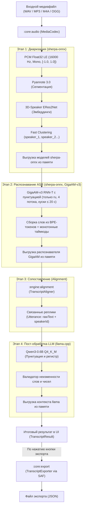
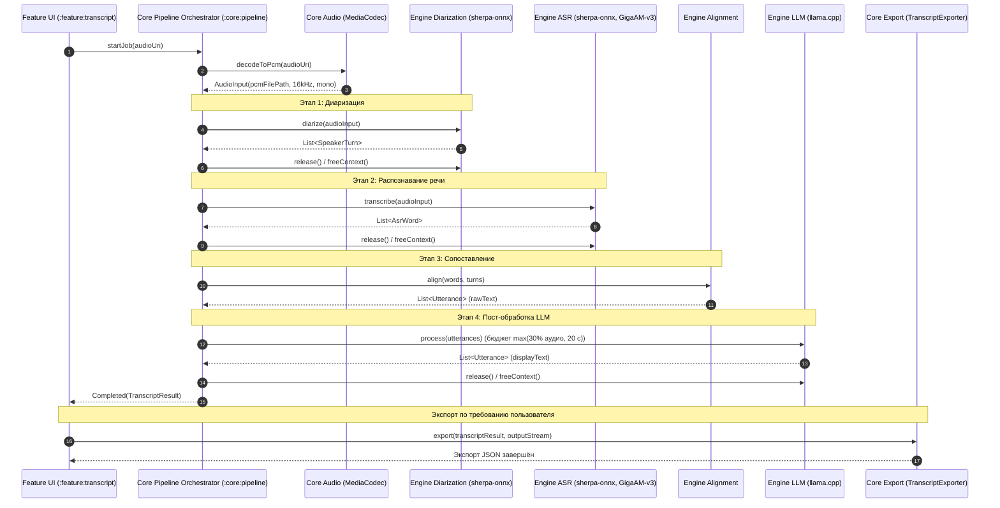
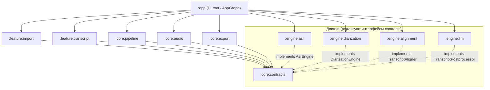

# Архитектура системы «Нейро-стенографист»

Документ описывает архитектуру автономного Android-приложения (APK), выполняющего расшифровку речи, диаризацию говорящих и пунктуационное пост-редактирование без подключения к сети Интернет.

---

## 1. Схема конвейера обработки (Pipeline)

Конвейер обработки аудио работает строго последовательно (stage-by-stage): модели загружаются в память по очереди и выгружаются сразу после завершения этапа, что предотвращает превышение лимита оперативной памяти на устройствах уровня Samsung Galaxy A51 (3–4 ГБ ОЗУ).

### Диаграмма последовательности (Sequence Diagram)

---

## 2. Реестр моделей и нативных рантаймов

Все модели поставляются внутри APK (в assets без сжатия) и запускаются локально через C++ JNI без сети.

| Компонент | Роль | Модель / Веса | Формат / Квантование | Размер | Хеш SHA-256 | Рантайм / Ревизия | Источник / Репозиторий | Лицензия |
|---|---|---|---|---|---|---|---|---|
| **ASR (encoder)** | Распознавание речи, только русский | `gigaam-v3-punct-encoder.int8.onnx` | ONNX INT8 | 224 570 820 Б | `369f35a71bf288d3b8e0391fabd8dba5f2314088d440bca474056b7b4b6e66bf` | `sherpa-onnx` Release `v2.0.1` `nemo_transducer`, `greedy_search` | `csukuangfj/sherpa-onnx-nemo-transducer-punct-giga-am-v3-russian-2025-12-16` HF commit `a6039be7ce` | MIT (GigaChat Team) |
| **ASR (decoder)** | RNN-T decoder | `gigaam-v3-punct-decoder.onnx` | ONNX FP32 | 4 600 132 Б | `38fc7475443ea2a26f63211ca350f73ac50fff824ab7a3876ee2bd610c53bbc4` | `sherpa-onnx` `v2.0.1` | то же | MIT |
| **ASR (joiner)** | RNN-T joiner | `gigaam-v3-punct-joiner.onnx` | ONNX FP32 | 2 712 896 Б | `602ff7017a93311aad34df1437c8d7f49911353c13d6eae7a6ee7b041339465c` | `sherpa-onnx` `v2.0.1` | то же | MIT |
| **ASR (tokens)** | Словарь BPE | `gigaam-v3-punct-tokens.txt` | text | 13 354 Б | `39abae20e692998290c574e606f11a9edef2902a1995463fcff63d1490cf22b7` | — | то же | MIT |
| **Diarization (Seg)** | Сегментация речи / VAD | `sherpa-onnx-pyannote-segmentation-3-0.onnx` | ONNX FP32 | 5 992 913 Б | `220ad67ca923bef2fa91f2390c786097bf305bceb5e261d4af67b38e938e1079` | `sherpa-onnx` Release `v2.0.1` | `csukuangfj/sherpa-onnx-pyannote-segmentation-3-0` | MIT |
| **Diarization (Emb)** | Извлечение эмбеддингов спикеров (используется) | `3dspeaker_speech_eres2net_base_sv_zh-cn_3dspeaker_16k.onnx` | ONNX FP32 | 39 593 761 Б | `1a331345f04805badbb495c775a6ddffcdd1a732567d5ec8b3d5749e3c7a5e4b` | `sherpa-onnx` Release `v2.0.1` | `k2-fsa/sherpa-onnx/releases/speaker-recongition-models` | Apache-2.0 |
| **Diarization (Emb), кандидат** | CAM++ для перебора против ERes2Net; в APK, в DI не подключена | `3dspeaker_speech_campplus_sv_zh_en_16k-common_advanced.onnx` | ONNX FP32 | 28 281 164 Б | `aa3cfc16963a10586a9393f5035d6d6b57e98d358b347f80c2a30bf4f00ceba2` | `sherpa-onnx` Release `v2.0.1` | `k2-fsa/sherpa-onnx/releases/speaker-recongition-models` | Apache-2.0 |
| **LLM Postprocessor** | Расстановка знаков и регистра | `qwen3-0.6b-q4_k_m.gguf` | GGUF Q4_K_M | 396 704 928 Б | `2883b98c1396be553c252b27382cae54baad12b4087e6bec86af024bd412afa9` | `llama.cpp` Commit `954de248` | Квантование `prithivMLmods/Qwen3-0.6B-GGUF` | Apache-2.0 |

Размеры и SHA-256 совпадают с `models/manifest.json` (версия 2.4). Whisper (`ggml-base.bin`) удалён из manifest, assets и DI. Нативный код `whisper.cpp` пока остаётся в `:engine:asr`, но приложение его не вызывает. После перебора диаризации в APK останется одна модель эмбеддингов.

> **Лицензионная чистота:** Все модели и библиотеки распространяются под открытыми разрешительными лицензиями (MIT и Apache-2.0) и не требуют сетевых ключей или обращения к внешним API.

---

## 3. Граф зависимостей модулей

Архитектура строго следует принципу слабой связанности. Feature-модули зависят **только от контрактов** (`:core:contracts`), а связывание конвейера (`:core:pipeline`) и движков (`:engine:*`) выполняется исключительно в модуле приложения (`:app`) через Dependency Injection (`AppGraph` / `PipelineEngines`).

### Назначение и изоляция модулей:

* **`:core:contracts`** — публичные DTO (`AudioInput`, `AsrWord`, `SpeakerTurn`, `Utterance`, `TranscriptResult`) и интерфейсы движков (`AsrEngine`, `DiarizationEngine`, `TranscriptAligner`, `TranscriptPostprocessor`). Зависит только от `kotlinx.coroutines`.
* **`:core:audio`** — декодирование любого входного аудио (WAV, MP3, M4A, OGG) через Android `MediaCodec` в канонический формат PCM (16 кГц, mono, float32 LE).
* **`:core:pipeline`** — дирижёр конвейера: последовательный запуск этапов, мониторинг прогресса, управление выгрузкой памяти и отмена задач.
* **`:core:export`** — детерминированный `TranscriptExporter`: генерация JSON строго по схеме задания через системный Storage Access Framework (SAF).
* **`:engine:asr`** — `GigaAmAsrEngine`: C-API `sherpa-onnx v2.0.1`, offline recognizer (`nemo_transducer`, `greedy_search`, `max_active_paths = 4`, 4 потока, 64 fbank, 16 кГц). Только русский язык: для другого языка задача завершается `Failed(ENGINE_FAILED)`, без падения приложения. Аудио режется на куски не длиннее 20 с; точка разреза выбирается в последних 5 с куска по минимуму RMS-энергии окна 100 мс с шагом 25 мс. PCM читается в память целиком.
* **`:engine:diarization`** — C-API `sherpa-onnx v2.0.1`: Pyannote 3.0 + ERes2Net, по 4 потока на сегментацию и эмбеддинги, CPU. Кластеризация динамическая (`num_clusters = -1`), `threshold = 0.75`, `min_duration_on = 0.5 с`, `min_duration_off = 0.5 с`. Кластеры с суммарной речью меньше 2 с (`minSpeakerTotalDurationMs = 2000`) переназначаются ближайшему по времени кластеру от 2 с. Если таких кластеров нет, остаются все. Затем соседние реплики одного спикера склеиваются, имена `speaker_1`, `speaker_2`… выдаются по первому появлению.
* **`:engine:alignment`** — слияние слов и интервалов реплик с дедупликацией на стыках и разделением фраз при смене спикера.
* **`:engine:llm`** — `llama.cpp` для расстановки пунктуации и капитализации; одна реплика за вызов, реплики длиннее 150 символов режутся на части.
* **`:feature:import`** — экран импорта с системным File Picker (SAF) и проверкой аудио.
* **`:feature:transcript`** — экран отображения готовой расшифровки со спикерами, прогресс-бар этапов и кнопка экспорта.

---

## 4. Использование оперативной памяти (RAM)

Поскольку модели выполняются **строго последовательно** и освобождаются сразу после своего этапа, пиковое потребление памяти приложением определяется не суммой моделей, а **пиком самого тяжёлого этапа**:

| Этап / Компонент | Потребление RAM (PSS) | Статус замера | Примечание |
|---|---|---|---|
| **Базовый процесс Android + UI** | ~120 МБ | Измерено на A51 | Базовый runtime приложения |
| **Этап 1: Диаризация (`sherpa-onnx`)** | пик 404 МБ PSS | Измерено на A51, main 977b691, русский диалог 73 с | Pyannote 3.0 + ERes2Net |
| **Этап 2: Распознавание (GigaAM-v3)** | не замерено | — | PSS для GigaAM на A51 ещё не снимали |
| **Этап 3: Сопоставление (`alignment`)** | < 10 МБ | Оценка | Быстрый алгоритмический проход в памяти |
| **Этап 4: Пост-обработка (`Qwen3-0.6B`)** | **пик 1125 МБ PSS** | **Измерено на A51, main 977b691, русский диалог 73 с** | Самый тяжёлый этап |
| **Пик приложения за весь цикл** | **1125 МБ PSS** | **Измерено на A51** | Замер с whisper в качестве ASR; с GigaAM не перемерен |

PCM читается с диска блоками по 64 КБ, но `GigaAmAsrEngine` складывает всю запись в один `FloatArray`: это 4 байта × 16 000 отсчётов в секунду, около 230 МБ на час аудио.

---

## 5. Бюджет времени и валидация LLM

1. **Лимит времени (30% от аудио):**
   - Время LLM-постобработки ограничено бюджетом **max(30% длительности записи, 20 с)**. Бюджет начинается после загрузки модели. Реплики обрабатываются по одной, и в результат идут только те, что успели обработаться. В `warnings` попадает предупреждение: сколько реплик обработано из скольких, а если ни одной, то что лимит времени исчерпан и показан исходный текст.
2. **Гарантированный Fallback:**
   - В случае превышения таймаута, нехватки ресурсов или ошибки нативного инференса LLM этап завершается мягко: в результат подставляется проверенный `rawText`, а в `TranscriptResult.warnings` добавляется предупреждение. Пайплайн никогда не падает.
3. **Защитный валидатор текста:**
   - После отработки LLM текст реплики проходит проверку: валидатор сравнивает нормализованные токены (без пунктуации и регистра) с исходным `rawText`.
   - Запрещено добавление, пропуск или изменение слов, чисел, дат и имён. При обнаружении любой семантической галлюцинации реплика автоматически откатывается к `rawText`.

---

## 6. Сборка слов и таймкодов (GigaAmAsrEngine)

1. **Слова из BPE-токенов.** Токен с префиксом `▁` или пробелом начинает новое слово, остальные дописываются к текущему. Токен только из знаков пунктуации (`, . ! ? : ; — - … « » "`) прикрепляется к предыдущему слову.
2. **Время слова.** `startMs` берётся от первого токена, `endMs` — от времени следующего токена (не меньше start + 100 мс).
3. **Монотонность внутри куска.** `start = max(prevEnd, word.start)`, `end = min(max(start + 50, word.end), chunkDurationMs)`; слово отбрасывается, если `start ≥ end`. К таймкодам добавляется смещение начала куска.
