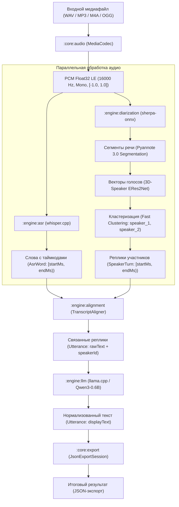
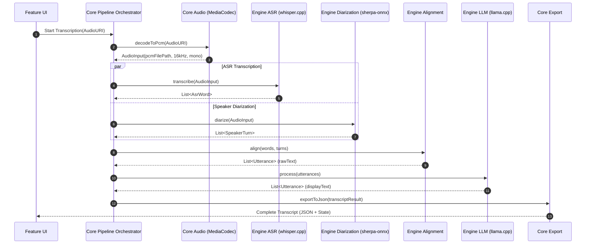
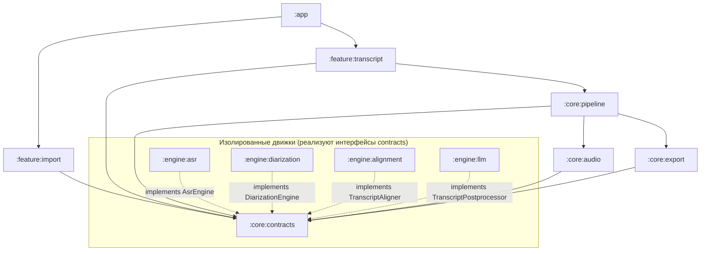

# Архитектура системы «Нейро-стенографист»

Документ описывает архитектуру автономного Android-приложения (APK), выполняющего расшифровку речи, диаризацию говорящих и пунктуационное пост-редактирование без подключения к сети Интернет.

---

## 1. Схема конвейера обработки (Pipeline)

Конвейер обработки аудио работает полностью локально на устройстве, используя многопоточный параллелизм на энергоэффективных и производительных ядрах мобильного процессора.

### Последовательность выполнения (Sequence Diagram)

---

## 2. Реестр моделей и нативных рантаймов

Все модели запускаются нативно через C++ JNI без облачных провайдеров и сети.

| Компонент | Роль | Модель / Веса | Формат / Квантование | Размер | Хеш SHA-256 | Рантайм / Ревизия | Лицензия |
|---|---|---|---|---|---|---|---|
| **ASR** | Распознавание речи | `ggml-base.bin` *(multilingual)* | GGML FP16 | 148.0 МБ | `60ed5bc3dd14eea856493d334349b405782ddcaf0028d4b5df4088345fba2efe` | `whisper.cpp` Tag `v1.7.1` Commit `ebca09a3d1` | MIT |
| **Diarization (Seg)** | Сегментация речи / VAD | `sherpa-onnx-pyannote-segmentation-3-0.onnx` | ONNX FP32 | 5 992 913 байт | `220ad67ca923bef2fa91f2390c786097bf305bceb5e261d4af67b38e938e1079` | `sherpa-onnx` Release `v2.0.1` | MIT |
| **Diarization (Emb)** | Извлечение эмбеддингов спикеров | `3dspeaker_speech_eres2net_base_sv_zh-cn_3dspeaker_16k.onnx` | ONNX FP32 | 39.59 МБ | `1a331345f04805badbb495c775a6ddffcdd1a732567d5ec8b3d5749e3c7a5e4b` | `sherpa-onnx` Release `v2.0.1` | Apache-2.0 |
| **LLM Postprocessor** | Расстановка знаков и регистра | `Qwen3-0.6B-Q4_K_M.gguf` | GGUF Q4_K_M, сторонняя квантовка prithivMLmods | 396704928 байт | `2883b98c1396be553c252b27382cae54baad12b4087e6bec86af024bd412afa9` | `llama.cpp`, commit `954de248ac6907dd05dc19f0f511ab18f2807a54` | Apache-2.0 |

### Происхождение LLM-весов

Исходная модель — **Qwen3-0.6B**. GGUF Q4_K_M получен из **сторонней квантовки [prithivMLmods/Qwen3-0.6B-GGUF](https://huggingface.co/prithivMLmods/Qwen3-0.6B-GGUF/tree/3fa3255253c99e212675c0825241518cdba8e42c)**, а не из официального репозитория Qwen. Закреплённая ревизия — `3fa3255253c99e212675c0825241518cdba8e42c`, [файл-источник](https://huggingface.co/prithivMLmods/Qwen3-0.6B-GGUF/resolve/3fa3255253c99e212675c0825241518cdba8e42c/Qwen3_0.6B.Q4_K_M.gguf). Лицензия поставки зафиксирована как **Apache-2.0** в manifest/dependencies. Автор исходной модели и поставщик квантованного файла — разные участники.

Авторитетный реестр файлов/хешей — [models/manifest.json](../models/manifest.json); LLM-runtime и источник квантовки — [dependencies.json](../src/android/engine/llm/dependencies.json). Веса не коммитятся. Замеры и текущие ограничения — [A51_LLM_CHECKPOINT.md](A51_LLM_CHECKPOINT.md) и [LLM_KV_PERFORMANCE.md](LLM_KV_PERFORMANCE.md).

> **Лицензионная чистота:** Все используемые компоненты распространяются под открытыми коммерчески применимыми лицензиями (MIT и Apache-2.0). Модели не имеют запретов на оффлайн-дистрибуцию внутри приложения.

---

## 3. Модульная структура и зависимости

Архитектура строго следует принципу направленных зависимостей: **UI → Feature → Pipeline → Contracts ← Engines**. Модули движков полностью изолированы друг от друга и не зависят от UI.

### Назначение модулей:

* **`:core:contracts`** — базовые DTO (`AudioInput`, `AsrWord`, `SpeakerTurn`, `Utterance`, `TranscriptResult`) и интерфейсы движков (`AsrEngine`, `DiarizationEngine`, `TranscriptAligner`, `TranscriptPostprocessor`). Зависит только от Kotlin Coroutines.
* **`:core:audio`** — декодирование любых аудиоформатов через системный Android MediaCodec в канонический PCM float32 LE 16000 Hz mono.
* **`:core:pipeline`** — дирижёр асинхронного выполнения: запускает параллельный инференс ASR и диаризации, управляет памятью, следит за жизненным циклом и отменой задач.
* **`:core:export`** — детерминированная сборка и валидация итогового JSON строго по спецификации задания (без участия LLM в сборке JSON-структуры во избежание галлюцинаций).
* **`:engine:asr`** — C++ JNI обёртка над `whisper.cpp`: статическая линковка, потоковое чтение аудио блоками по 64 КБ, аппаратная гарантия строгой монотонности таймкодов (`start = max(start, prevEnd)`).
* **`:engine:diarization`** — C++ JNI обёртка над C-API `sherpa-onnx v2.0.1`: Pyannote 3.0 + ERes2Net с динамической кластеризацией (`num_clusters = -1`) и стабильными идентификаторами спикеров (`speaker_1`, `speaker_2`...).
* **`:engine:alignment`** — алгоритмическое совмещение слов и реплик спикеров, сглаживание пауз, разрешение наложений и дедупликация слов на стыках.
* **`:engine:llm`** — нативный `llama.cpp` для постобработки текста (расстановка знаков препинания и заглавных букв без искажения распознанных слов).
* **`:feature:import`** — системный File Picker (SAF), предварительная валидация аудио.
* **`:feature:transcript`** — экран отображения расшифровки, прогресс-бар этапов, синхронизированное воспроизведение аудио с подсветкой активной реплики, кнопка экспорта.

---

## 4. Гарантии стабильности и ограничения по ресурсам

1. **Бюджет оперативной памяти (RAM):**
   - Пиковое потребление ASR (`ggml-base`): ~160 МБ.
   - Пиковое потребление Diarization (`Pyannote + ERes2Net`): ~80 МБ.
   - Пиковое потребление LLM (`Qwen3-0.6B Q4`): ~480 МБ.
   - Общее пиковое потребление всего стека не превышает **~750–850 МБ**, что с большим запасом укладывается в целевой бюджет 2.0 ГБ на типичных Android-устройствах (3–4 ГБ ОЗУ).
2. **Защита от OOM на длинных записях:**
   - Никакой движок не загружает многомегабайтные файлы целиком в Java-кучу: чтение PCM происходит через `FileInputStream` порциями по 64 КБ с прямой передачей указателей в нативный C++ слой.
3. **Монотонность временных меток:**
   - Интервалы строго упорядочены: для любых соседних слов $w_i, w_{i+1}$ выполняется $\text{startMs}_{i+1} \ge \text{endMs}_i$ и $\text{startMs} < \text{endMs} \le \text{durationMs}$.

