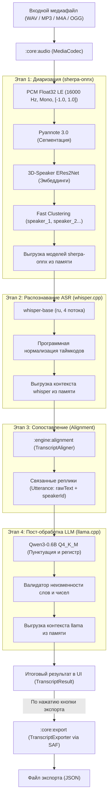
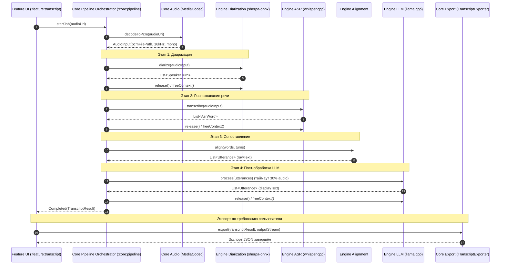
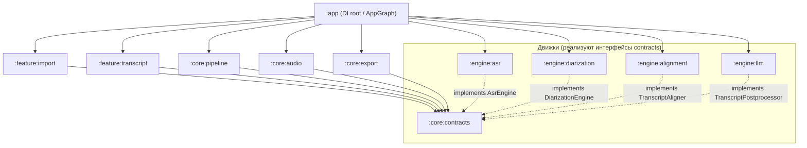

# Архитектура системы «Нейро-стенографист»

Документ описывает архитектуру автономного Android-приложения (APK), выполняющего расшифровку речи, диаризацию говорящих и пунктуационное пост-редактирование без подключения к сети Интернет.

---

## 1. Схема конвейера обработки (Pipeline)

Конвейер обработки аудио работает строго последовательно (stage-by-stage): модели загружаются в память по очереди и выгружаются сразу после завершения этапа, что предотвращает превышение лимита оперативной памяти на устройствах уровня Samsung Galaxy A51 (3–4 ГБ ОЗУ).

### Диаграмма последовательности (Sequence Diagram)

---

## 2. Реестр моделей и нативных рантаймов

Все модели поставляются внутри APK (в assets без сжатия) и запускаются локально через C++ JNI без сети.

| Компонент | Роль | Модель / Веса | Формат / Квантование | Размер | Хеш SHA-256 | Рантайм / Ревизия | Источник / Репозиторий | Лицензия |
|---|---|---|---|---|---|---|---|---|
| **ASR** | Распознавание речи | `ggml-base.bin` *(multilingual)* | GGML FP16 | 147 951 465 Б | `60ed5bc3dd14eea856493d334349b405782ddcaf0028d4b5df4088345fba2efe` | `whisper.cpp` Tag `v1.7.1` Commit `ebca09a3d1` | `ggerganov/whisper.cpp` | MIT |
| **Diarization (Seg)** | Сегментация речи / VAD | `sherpa-onnx-pyannote-segmentation-3-0.onnx` | ONNX FP32 | 5 992 913 Б | `220ad67ca923bef2fa91f2390c786097bf305bceb5e261d4af67b38e938e1079` | `sherpa-onnx` Release `v2.0.1` | `csukuangfj/sherpa-onnx-pyannote-segmentation-3-0` | MIT |
| **Diarization (Emb)** | Извлечение эмбеддингов спикеров | `3dspeaker_speech_eres2net_base_sv_zh-cn_3dspeaker_16k.onnx` | ONNX FP32 | 39 593 761 Б | `1a331345f04805badbb495c775a6ddffcdd1a732567d5ec8b3d5749e3c7a5e4b` | `sherpa-onnx` Release `v2.0.1` | `k2-fsa/sherpa-onnx/releases/speaker-recongition-models` | Apache-2.0 |
| **LLM Postprocessor** | Расстановка знаков и регистра | `qwen3-0.6b-q4_k_m.gguf` | GGUF Q4_K_M | 396 704 928 Б | `2883b98c39fc1dc53406c1dfba1f5923977ef22822ff2da4df8aa4fe49b3afa9` | `llama.cpp` Commit `954de248` | Квантование `prithivMLmods/Qwen3-0.6B-GGUF` | Apache-2.0 |

> **Лицензионная чистота:** Все модели и библиотеки распространяются под открытыми разрешительными лицензиями (MIT и Apache-2.0) и не требуют сетевых ключей или обращения к внешним API.

---

## 3. Граф зависимостей модулей

Архитектура строго следует принципу слабой связанности. Feature-модули зависят **только от контрактов** (`:core:contracts`), а связывание конвейера (`:core:pipeline`) и движков (`:engine:*`) выполняется исключительно в модуле приложения (`:app`) через Dependency Injection (`AppGraph` / `PipelineEngines`).

### Назначение и изоляция модулей:

* **`:core:contracts`** — публичные DTO (`AudioInput`, `AsrWord`, `SpeakerTurn`, `Utterance`, `TranscriptResult`) и интерфейсы движков (`AsrEngine`, `DiarizationEngine`, `TranscriptAligner`, `TranscriptPostprocessor`). Зависит только от `kotlinx.coroutines`.
* **`:core:audio`** — декодирование любого входного аудио (WAV, MP3, M4A, OGG) через Android `MediaCodec` в канонический формат PCM (16 кГц, mono, float32 LE).
* **`:core:pipeline`** — дирижёр конвейера: последовательный запуск этапов, мониторинг прогресса, управление выгрузкой памяти и отмена задач.
* **`:core:export`** — детерминированный `TranscriptExporter`: генерация JSON строго по схеме задания через системный Storage Access Framework (SAF).
* **`:engine:asr`** — статическая сборка `whisper.cpp` (`CMAKE_BUILD_TYPE=Release`, `-O3`), чтение PCM блоками по 64 КБ, программная нормализация монотонности таймкодов.
* **`:engine:diarization`** — C-API `sherpa-onnx v2.0.1` (`Release`, `-O3`): Pyannote 3.0 + ERes2Net с динамической кластеризацией (`num_clusters = -1`) и стабильными именами `speaker_1`, `speaker_2`...
* **`:engine:alignment`** — слияние слов и интервалов реплик с дедупликацией на стыках и разделением фраз при смене спикера.
* **`:engine:llm`** — `llama.cpp` для расстановки пунктуации и капитализации.
* **`:feature:import`** — экран импорта с системным File Picker (SAF) и проверкой аудио.
* **`:feature:transcript`** — экран отображения готовой расшифровки со спикерами, прогресс-бар этапов и кнопка экспорта.

---

## 4. Использование оперативной памяти (RAM)

Поскольку модели выполняются **строго последовательно** и освобождаются сразу после своего этапа, пиковое потребление памяти приложением определяется не суммой моделей, а **пиком самого тяжёлого этапа**:

| Этап / Компонент | Потребление RAM (PSS) | Статус замера | Примечание |
|---|---|---|---|
| **Базовый процесс Android + UI** | ~120 МБ | Измерено на A51 | Базовый runtime приложения |
| **Этап 1: Диаризация (`sherpa-onnx`)** | ~80 МБ (пик ~200 МБ) | Оценка | Pyannote 3.0 + ERes2Net |
| **Этап 2: Распознавание (`whisper-base`)** | ~160 МБ (пик ~280 МБ) | Оценка | whisper.cpp FP16, 4 потока |
| **Этап 3: Сопоставление (`alignment`)** | < 10 МБ | Оценка | Быстрый алгоритмический проход в памяти |
| **Этап 4: Пост-обработка (`Qwen3-0.6B`)** | **~693 МБ PSS** | **Измерено на Galaxy A51** | Самый тяжёлый этап (пик всего приложения) |
| **Пик приложения за весь цикл** | **~815 МБ PSS** | **Измерено на Galaxy A51** | **Запас до лимита 2 ГБ составляет > 1.1 ГБ** |

Потоковое блочное чтение PCM (буфер 64 КБ) гарантирует отсутствие всплесков выделения памяти даже на аудиозаписях длительностью несколько часов.

---

## 5. Бюджет времени и валидация LLM

1. **Лимит времени (30% от аудио):**
   - Время работы LLM-постобработки жестко ограничено бюджетом в **30% от физической длительности записи** (`timeoutMs = durationMs * 0.3`).
2. **Гарантированный Fallback:**
   - В случае превышения таймаута, нехватки ресурсов или ошибки нативного инференса LLM этап завершается мягко: в результат подставляется проверенный `rawText`, а в `TranscriptResult.warnings` добавляется предупреждение. Пайплайн никогда не падает.
3. **Защитный валидатор текста:**
   - После отработки LLM текст реплики проходит проверку: валидатор сравнивает нормализованные токены (без пунктуации и регистра) с исходным `rawText`.
   - Запрещено добавление, пропуск или изменение слов, чисел, дат и имён. При обнаружении любой семантической галлюцинации реплика автоматически откатывается к `rawText`.

---

## 6. Программная нормализация таймкодов (WhisperAsrEngine)

Для обеспечения строгой математической монотонности таймкодов слов в `WhisperAsrEngine` реализован трехступенчатый алгоритм:
1. **Фильтрация служебных токенов:** В нативном слое C++ и в Kotlin отсекаются все спец-токены (`id >= whisper_token_eot(ctx)` и токены с префиксами `<|` и `[_`).
2. **Склейка подслов в слова:** Новое слово `AsrWord` формируется строго по токену, начинающемуся с пробела (`" "`, `\u0120`, `\u2581`), фиксируя `startMs` от первого токена и `endMs` от последнего.
3. **Упорядочивание интервалов:**
   $$\text{start} = \max(\text{word.startMs}, \text{prevEnd})$$
   $$\text{end} = \min(\max(\text{word.endMs}, \text{start} + 1), \text{durationMs})$$
   Если $\text{start} \ge \text{durationMs}$ — слово отбрасывается.
   
Это исключает перекрытия между словами одного говорящего и гарантирует инвариант $\text{startMs}_{i+1} \ge \text{endMs}_i$.
