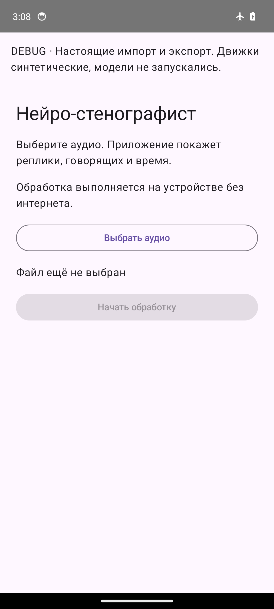
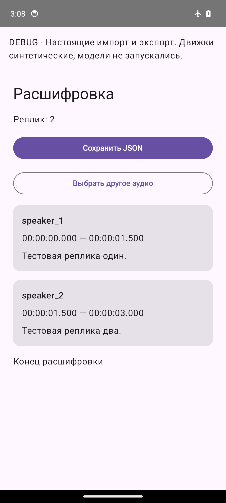
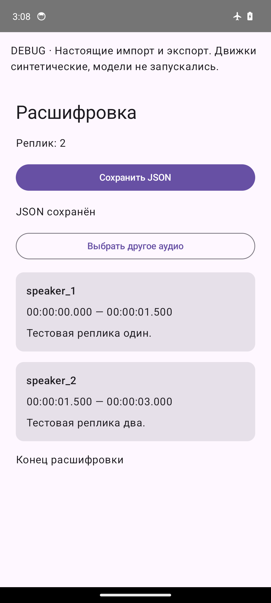

# Исходный код

Android-проект расположен в [android/](android/); Gradle-команды выполняются из src/android. Модули UI/feature, core и engine реализуют локальную обработку без облачного inference. Основной язык — русский, английский поддерживается.

Начать с [SETUP.md](../docs/SETUP.md) и [ARCHITECTURE.md](../docs/ARCHITECTURE.md). SETUP содержит исторические разделы: наличие bootstrap/Debug APK не подтверждает realEngines release; B6 интегрирован merge f48d417 в main, источник статуса — [PR #24](https://github.com/ikeepthatjuice/hackaton_mifi_sokolovklum/pull/24). Здесь команды сборки и архитектурные описания повторно не копируются.

Проверки: [Q1_TEST_PLAN.md](../docs/Q1_TEST_PLAN.md), [PROTOCOL.md](../docs/PROTOCOL.md), [TEST_RESULTS.md](../docs/TEST_RESULTS.md), [ограничения](../docs/LIMITATIONS.md). Границы LLM и замеры: [русская валидация](../docs/LLM_RUSSIAN_VALIDATION.md), [A51](../docs/A51_LLM_CHECKPOINT.md), [KV/batching](../docs/LLM_KV_PERFORMANCE.md). Пример host-окружения — [config/example.env](../config/example.env); приложение этот файл не читает.

Правила работы и владельцы путей — [AGENTS.md](../AGENTS.md). Ветки feat/<роль>-<задача>, Pull Request и независимое ревью; напрямую в main не пушить и свой PR не сливать. ARCHITECTURE принадлежит Илье. Core contracts не копировать и не менять без согласования. Аудио кейса, реальные тексты/экспорты, веса и секреты в git не помещать.

Материалы сдачи: [результаты](../artifacts/test-results/README.md), [место для демо](../artifacts/demo/README.md).

## Как пользоваться

1. Скачайте release-APK из материалов команды на Android-устройство и откройте файл для установки. Если Android запросит разрешение на установку из этого источника, разрешите установку APK команды.
2. Откройте приложение. Необходимые модели встроены в APK; при первом запуске они копируются во внутреннее хранилище. Для анализа подключение к интернету не требуется.
3. Нажмите **«Выбрать аудио»** и выберите локальную запись в системном окне выбора файла. Отмена выбора возвращает в приложение; обработка при этом не запускается.
4. Нажмите **«Начать обработку»**. На экране последовательно отображаются этапы, включая **«Подготовка моделей…»**. Дождитесь результата; для остановки нажмите **«Отменить»**.
5. На экране **«Расшифровка»** просмотрите реплики: идентификатор говорящего, время начала и конца, текст. Длинный список прокручивается. Если показано предупреждение об обработке **N из M** реплик, ознакомьтесь с ним: LLM обработала только часть текста, оставшиеся реплики сохранены в исходном виде.
6. Нажмите **«Сохранить JSON»**, выберите папку и подтвердите имя файла в системном окне сохранения. Дождитесь сообщения **«JSON сохранён»**. Во время записи кнопка показывает **«Сохранение…»** и недоступна.
7. Для следующей записи нажмите **«Выбрать другое аудио»**. Перед этим сохраните нужный результат в JSON.

### Если возникла ошибка

- **«Освободите N МБ»**: освободите указанное место во внутреннем хранилище и нажмите **«Повторить»**.
- Не удалось прочитать аудио или формат не поддерживается: нажмите **«Выбрать другое аудио»** и выберите доступный локальный файл.
- Не удалось сохранить JSON: повторите сохранение и выберите доступную для записи папку.

### Пример интерфейса на синтетике

Скриншоты debug-сценария на эмуляторе: движки синтетические, модели не запускались. Они показывают интерфейс и сохранение JSON, а не качество распознавания.

| Выбор аудио | Просмотр результата | JSON сохранён |
| --- | --- | --- |
|  |  |  |
